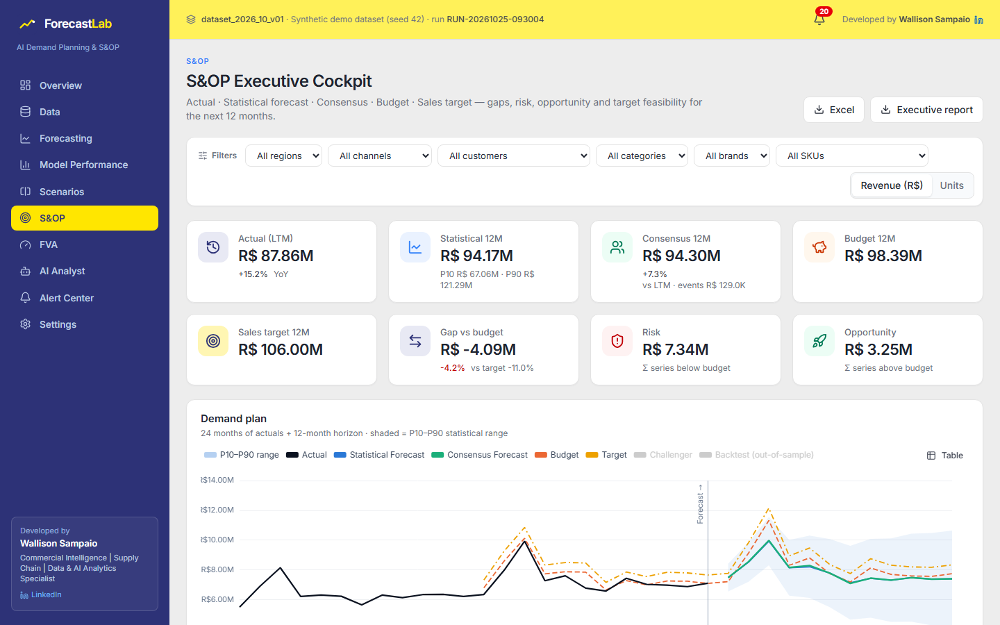
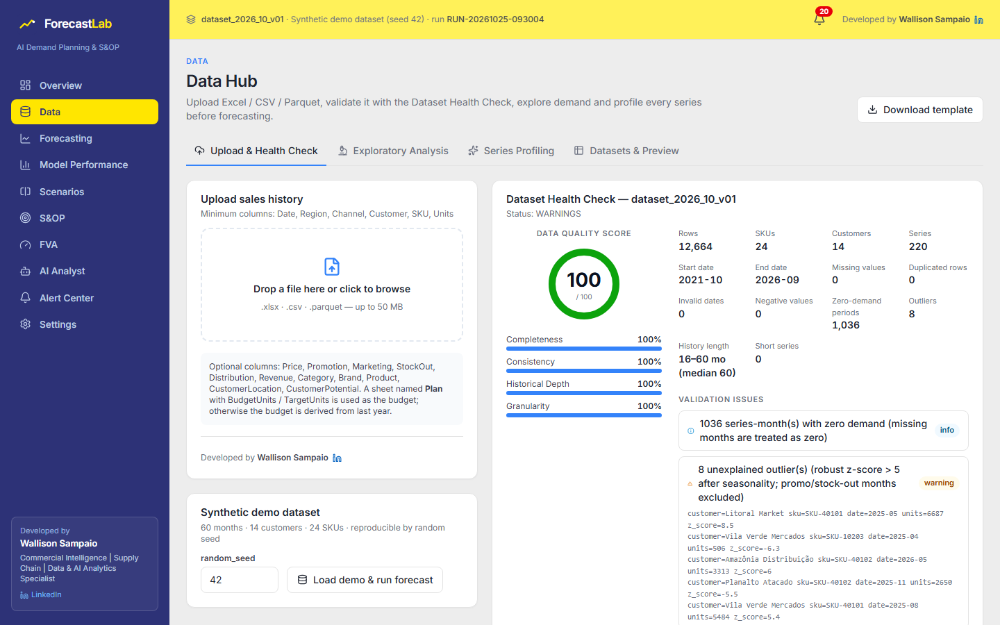
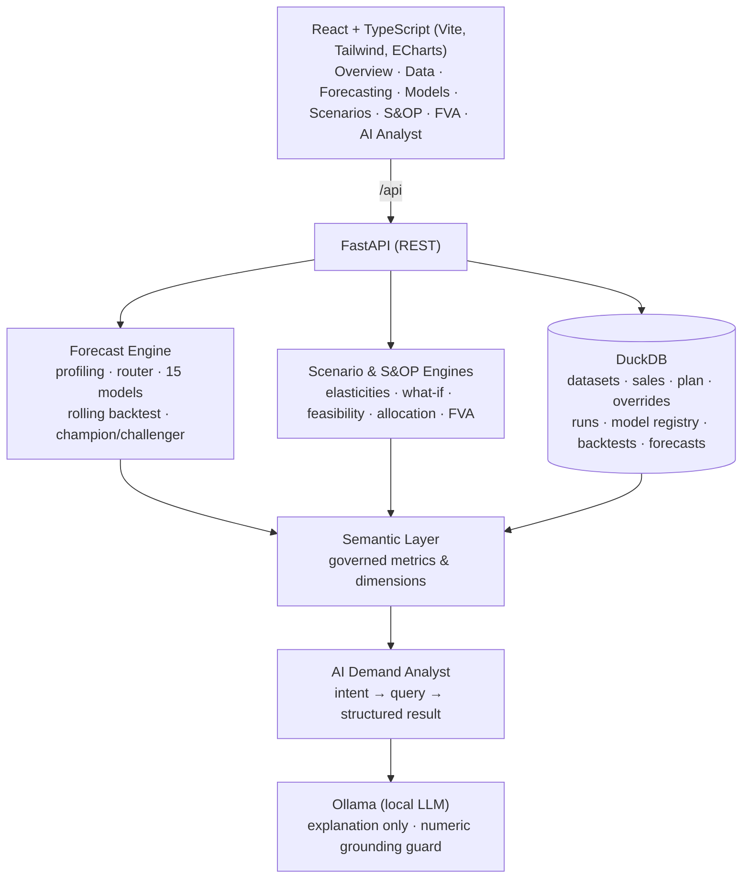

<div align="center">


# ForecastLab

## AI Demand Planning & S&OP Decision Intelligence Platform

**LinkedIn Portfolio Project**

**Developed by Wallison Sampaio**
Commercial Intelligence | Supply Chain | Data & AI Analytics Specialist
LinkedIn: [www.linkedin.com/in/wallisonsampaio](https://www.linkedin.com/in/wallisonsampaio)

*Desenvolvido por Wallison Sampaio — Especialista em Inteligência Comercial | Supply Chain | Data & AI Analytics*


</div>

---

> **I built ForecastLab — a full-stack AI-powered Demand Planning & S&OP platform that backtests multiple forecasting
> models, selects the best model per SKU/customer, simulates commercial scenarios and evaluates whether business
> targets are statistically realistic.**

ForecastLab is not "an app that predicts demand". It is a complete **Demand Planning and S&OP decision platform**
that combines statistical forecasting, model selection, rolling-origin backtesting, commercial scenarios, target
intelligence, forecast governance (FVA, model & run registries) and a **local AI analyst** in one decoupled
full-stack application — running 100% locally, with **zero paid APIs**.

## Screenshots

| S&OP Executive Cockpit | Forecast Workspace |
|---|---|
|  |  |
| **Model Performance — Champion vs Challenger** | **Scenario Planning — Base vs Aggressive** |
|  |  |
| **AI Demand Analyst** | **Data Quality Check** |
|  |  |

> Regenerate screenshots any time with `scripts/capture_screenshots.ps1` (headless Edge/Chrome, 1440×900).

## The problem

Demand planners juggle spreadsheets of history, a statistical forecast nobody fully trusts, commercial "gut feel"
adjustments, a budget built from last year, and a sales target negotiated top-down. The S&OP meeting then debates
numbers instead of decisions:

* Which forecast is right — and how accurate has it actually been?
* Did the planners' overrides make the forecast better or worse?
* Is next year's target realistic, a stretch, or simply impossible?
* What would it take (distribution, price, promotions) to close the gap?

## The solution

```text
Raw Historical Data → Data Quality → Statistical Modeling → Model Competition → Forecast
  → Business Inputs → Scenario Planning → S&OP → Decision Intelligence → AI Explanation
```

| Step | What ForecastLab does |
|---|---|
| **Upload & validate** | `.xlsx` / `.csv` / `.parquet`, EN/PT column aliases, Dataset Health Check, **Data Quality Score (0–100)**, execution blocked on critical errors |
| **Explore** | Trend, seasonality index, volatility, intermittency, promotion and distribution effects |
| **Profile** | Every Customer × SKU series classified (Stable, Trending, Declining, Seasonal, Intermittent, Promo/Distribution Driven, Structural Change, Volatile, Short History, Inactive) |
| **Model competition** | **15 models** routed by pattern, rolling-origin backtest, WMAPE / Bias / MAE / RMSE / MAPE / sMAPE / MASE, **Champion & Challenger**, model confidence |
| **Probabilistic forecast** | 3–24 month horizon (default 12), **P10 / P50 / P90** from out-of-sample errors |
| **Consensus** | Commercial overrides from an **event library** → Baseline + Incremental = **Consensus Forecast** |
| **Scenarios** | Base / Conservative / Aggressive / Custom, What-If engine with **elasticities estimated from history** |
| **S&OP** | Actual vs Statistical vs Consensus vs Budget vs Target, gaps, risk & opportunity, **Target Feasibility Engine**, **goal allocation** |
| **Governance** | **Forecast Value Added**, model registry, forecast run registry, dataset versioning, alert center |
| **AI Analyst** | Chat in EN/PT: intent → semantic layer → engines → grounded explanation (local **Ollama**) with dynamic charts |
| **Export** | Planning workbook (Excel), executive Excel and self-contained executive HTML report |

## Architecture



Detailed design: [docs/architecture.md](docs/architecture.md).

## Stack

| Layer | Technology |
|---|---|
| Frontend | React 19, TypeScript (strict), Vite 7, Tailwind CSS 4, Apache ECharts, TanStack Query, Zustand |
| Backend | Python, FastAPI, pandas, NumPy, SciPy, statsmodels, scikit-learn |
| Storage | DuckDB (single local file), Parquet / CSV / XLSX |
| AI | Ollama (`llama3.2:3b` by default) — optional; deterministic narrative fallback |
| Quality | pytest (100+ tests), Vitest + Testing Library, Ruff (lint + format), mypy, ESLint, Prettier |
| Delivery | Docker Compose (frontend + backend + ollama), GitHub Actions CI |

## Forecasting methodology

* **Series profiling** — ADI / CV² (Syntetos–Boylan), STL trend & seasonal strength, single change-point test
  (two-segment mean vs. linear trend), promotion lift and distribution correlation → series type + reason.
* **Model Candidate Router** — only plausible models compete (e.g. Croston/SBA/TSB for intermittent,
  Holt-Winters/ETS/SARIMA for seasonal); Naive is always the benchmark.
* **15 models** — Naive, Seasonal Naive, Moving Average · SES, Holt (damped), Holt-Winters, ETS (auto AICc) ·
  ARIMA, SARIMA (airline) · Croston, SBA, TSB · Ridge Regression with trend/seasonality/promotion/price/distribution/
  merchandising/marketing/holidays · Random Forest, Gradient Boosting (lag-12 + calendar + drivers).
* **Selection** — rank by WMAPE, then |Bias|, then RMSE → Champion and Challenger; **model confidence** (High/Medium/
  Low) from error, fold stability, history depth and champion margin.
* **Intervals** — P10/P90 from the champion's **out-of-sample** backtest RMSE, widened with √horizon.
* **Hierarchy** — Customer × SKU forecasts reconciled **bottom-up** to every level (top-down by historical shares
  also available; MinT on the roadmap).

Full details: [docs/forecasting.md](docs/forecasting.md).

## Backtesting methodology

Rolling-origin cross validation with an expanding window (default 4 folds × 3 months = the last 12 months):

```text
TRAIN                      TEST
Oct-2021 → Sep-2025        Oct–Dec 2025
Oct-2021 → Dec-2025        Jan–Mar 2026
Oct-2021 → Mar-2026        Apr–Jun 2026
Oct-2021 → Jun-2026        Jul–Sep 2026
```

**Leakage protection** (enforced by tests in `backend/tests/test_backtest.py`): models only receive `y[:origin]`;
drivers in the test window are **frozen at their last known regular level** (ex-ante evaluation — the model never
sees the promotions or prices that actually happened); stock-out cleaning uses training data only; changing the
values inside a test window never changes that fold's forecast.

## AI architecture

```text
User question → Intent extraction (bilingual rules, LLM fallback) → Semantic query
             → DuckDB / Forecast / Scenario / S&OP / FVA engines → Structured result
             → LLM explanation (Ollama) → Numeric grounding check → Answer + KPIs + chart + table
```

The LLM **never produces numbers**. Every figure in an answer must be traceable to the structured result; if the
LLM writes a number that is not in the facts, the answer is rejected and the deterministic narrative is used.
Response contract: `{answer, insights, metrics, chart, recommendations, filters}` + computation metadata.
See [docs/ai_analyst.md](docs/ai_analyst.md).

## Installation

### Docker (recommended)

```bash
git clone <repository> forecastlab
cd forecastlab
docker compose up
```

Open **http://localhost:3000**. The first start generates the synthetic dataset and runs the first forecast
(a few minutes); Ollama downloads the model once (~2 GB).

### Local development (without Docker)

Backend (Python 3.11+):

```bash
cd backend
python -m venv .venv
.venv/Scripts/python -m pip install -r requirements-dev.txt   # macOS/Linux: .venv/bin/python
.venv/Scripts/python -m uvicorn app.main:app --port 8000
```

Frontend (Node 20.19+):

```bash
cd frontend
npm install
npm run dev
```

Optional local AI: install [Ollama](https://ollama.com), then `ollama pull llama3.2:3b`. Without it, the AI Analyst
uses the deterministic narrative engine (every number is still computed by ForecastLab).

### Tests & quality

```bash
cd backend && .venv/Scripts/python -m pytest
cd frontend && npm test && npm run lint
```

## Demo dataset

`backend/synthetic_data_generator` builds a **reproducible** dataset (`random_seed`) with plausible economics:
60 months (Oct-2021 → Sep-2026), 5 regions, 5 channels, 14 fictitious customers, 4 categories, 8 brands, 24 SKUs,
220 Customer × SKU series and every PRD field (Price, Promotion, Distribution, StockOut, Holiday,
MarketingInvestment, MerchandisingEvent, CustomerPotential…).

* Nine demand patterns (stable, trending, declining, seasonal, intermittent, promo-driven, distribution-driven,
  structural change, volatile) plus a product launch and delistings.
* Detectable events: Black Friday, Christmas, Carnaval (moving date), Mother's Day, summer/winter, promotions,
  merchandising, store openings, distribution gains/losses, stock-outs, price increases/reductions.
* Annual budget & sales targets (with realistic optimism/under-estimation), 380+ historical planner overrides for
  FVA, and pending commercial events for the consensus.

```bash
cd backend
.venv/Scripts/python -m synthetic_data_generator --seed 42 --out ../data/synthetic --samples ../data/samples
```

`data/samples/forecastlab_sample_upload.xlsx` is a ready-to-upload file (South & Midwest regions).

## Repository structure

```text
forecastlab/
├── frontend/            React + TypeScript app (pages, components, charts, hooks, services, types)
├── backend/
│   ├── app/             api · ingestion · validation · forecasting · backtesting · metrics · model_selection
│   │                    reconciliation · scenarios · sop · fva · alerts · semantic_layer · ai · exports · services
│   ├── synthetic_data_generator/
│   └── tests/
├── data/                synthetic/ (generated) · samples/ (upload examples)
├── database/            local DuckDB file (created at runtime)
├── docs/                architecture, forecasting, data model, API, AI analyst, scenarios, S&OP, security…
├── docker/              Dockerfiles + nginx
├── screenshots/
├── docker-compose.yml
└── .github/workflows/ci.yml
```

## Documentation

[Architecture](docs/architecture.md) · [Forecasting](docs/forecasting.md) · [Data model](docs/data_model.md) ·
[API](docs/api.md) · [AI Analyst](docs/ai_analyst.md) · [Scenarios](docs/scenarios.md) · [S&OP](docs/sop.md) ·
[Enterprise readiness](docs/enterprise_readiness.md) · [Security](docs/security.md) ·
[LinkedIn kit](docs/linkedin_kit.md)

## Roadmap

* Phase 1 — Portfolio / Local ✅ (this repository)
* Next: MinT / middle-out reconciliation, global ML models (LightGBM across series), conformal intervals,
  approval workflow for overrides, PDF executive report, dark mode, i18n of the UI.
* Phase 2 — Enterprise ready: PostgreSQL / Azure SQL, Data Lake, Entra ID + RBAC, enterprise LLM, ERP/SAP connectors,
  Snowflake / Databricks, AKS / Container Apps, Terraform — see [docs/enterprise_readiness.md](docs/enterprise_readiness.md).

## White-label (optional client logo)

For private demos to a specific company, ForecastLab can show a "Prepared for" client logo next to its own brand.
The logo file and its setting stay on your machine (git-ignored) — see
[frontend/public/brand/README.md](frontend/public/brand/README.md). Only use logos you are authorized to use.

## Security

Local-first and safe by default: no credentials or API keys are needed or stored, the API and Docker ports bind to
`127.0.0.1`, uploads are size/type-limited, and the repository contains synthetic data only. There is no
authentication in this MVP, so do not deploy it publicly with real data. See [SECURITY.md](SECURITY.md) and
[docs/security.md](docs/security.md).

## Disclaimer

All data in this project is **synthetic and fictitious**, generated by code in this repository. No real company,
customer, product or confidential information is represented. Forecasts are statistical estimates for
demonstration purposes.

---

<div align="center">

**ForecastLab**

**Developed by Wallison Sampaio**
Commercial Intelligence | Supply Chain | Data & AI Analytics Specialist
[www.linkedin.com/in/wallisonsampaio](https://www.linkedin.com/in/wallisonsampaio)

</div>
