<div align="center">


# ForecastLab

## Plataforma de Demand Planning e S&OP com IA para decisões comerciais

**Projeto de portfólio — LinkedIn**

**Desenvolvido por Wallison Sampaio — Especialista em Inteligência Comercial | Supply Chain | Data & AI Analytics**

*Developed by Wallison Sampaio — Commercial Intelligence | Supply Chain | Data & AI Analytics Specialist*

LinkedIn: [www.linkedin.com/in/wallisonsampaio](https://www.linkedin.com/in/wallisonsampaio)


</div>

---

> **Construí o ForecastLab — uma plataforma full-stack de Demand Planning e S&OP com IA que faz o backtest de
> vários modelos de forecast, escolhe o melhor modelo por SKU/cliente, simula cenários comerciais e avalia se as
> metas do negócio são estatisticamente realistas.**

O ForecastLab não é "um app que prevê demanda". É uma **plataforma completa de decisão para Demand Planning e
S&OP** que reúne forecast estatístico, seleção de modelos, backtest com origem móvel (rolling-origin), cenários
comerciais, inteligência de metas, análise de desvios com causa raiz, governança do forecast (FVA, registro de
modelos e de execuções) e um **analista de IA local** em uma única aplicação full-stack desacoplada — rodando 100%
na máquina, **sem nenhuma API paga**.

Toda a experiência está em **português do Brasil**: menus, gráficos, tabelas, alertas, respostas da IA, exportações
e até os dados de demonstração (regiões, canais, categorias, tipos de evento), com números no padrão brasileiro
(`R$ 94,30 mi`, `14,8%`, `dez/2026`).

## A jornada: Entrada → Relatório → Desvios

A interface é uma **jornada guiada em três etapas**, na ordem em que uma reunião de S&OP precisa das respostas, e
um conjunto de ferramentas para o trabalho do dia a dia:

| Etapa | Pergunta que responde | O que o usuário vê |
|---|---|---|
| **1 · Entrada — dados e modelos** | "A base está pronta, os modelos competiram e posso confiar no número?" | Validação da base, placar da competição de modelos (vitórias por modelo) e um **veredito de confiança** com 4 KPIs e um único gráfico fora da amostra |
| **2 · Relatório executivo** | "Qual é a mensagem para a reunião e o que precisamos decidir?" | **7 capítulos** em storytelling (Resumo, Realizado, Precisão, Próximos 12 meses, Gap vs orçamento, Meta, Decisões); cada título afirma a conclusão com números, com um visual e até 3 leituras |
| **3 · Desvios — deep dive** | "Onde, por quê e quando desviamos — e o que faço agora?" | Lentes **Plano** (consenso/real × orçamento/meta) e **Previsão** (real × forecast fora da amostra): ONDE · POR QUÊ (ponte preço/volume/mix ou causas do erro) · QUANDO · QUAIS séries tratar primeiro, com ações |

**Ferramentas:** Workspace de forecast · Cenários e metas · Alertas · Analista de IA. **Governança:** Modelos e FVA
· Bases de dados.

Exemplo na base de demonstração — a ideia central do relatório: *"Vamos crescer 7,3% nos próximos 12 meses, mas
fechar R$ 4,09 mi abaixo do orçamento: 2 clientes concentram 59% das perdas e a meta tem 29% de chance."*

O desenho segue boas práticas de mercado — Pirâmide de Minto/SCQA, *Storytelling with Data* (Knaflic), notação
IBCS, o mantra de Shneiderman, gestão por exceção (Pareto), ponte preço/volume/mix, decomposição do erro em viés ×
ruído e causas controláveis × inerentes, e FVA. Racional completo e regras de orçamento visual em
[docs/jornada.md](docs/jornada.md).

## Telas

| 1 · Entrada — dados, modelos e confiança | 2 · Relatório executivo — Resumo |
|---|---|
| 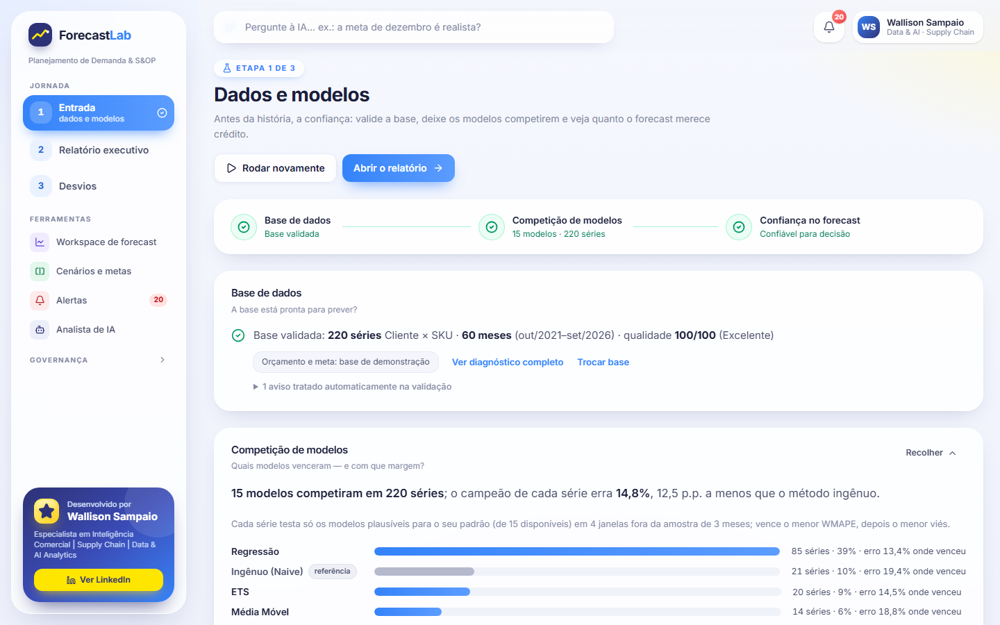 | 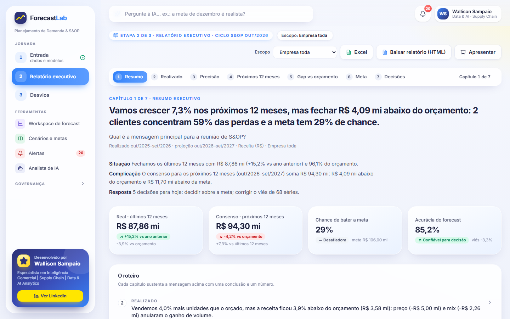 |
| **2 · Relatório executivo — Gap vs orçamento** | **3 · Desvios — lente Plano (Consenso × Orçamento por cliente)** |
| 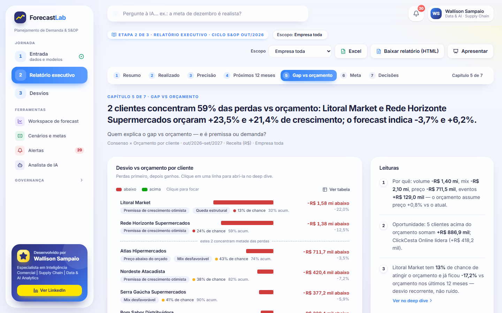 | 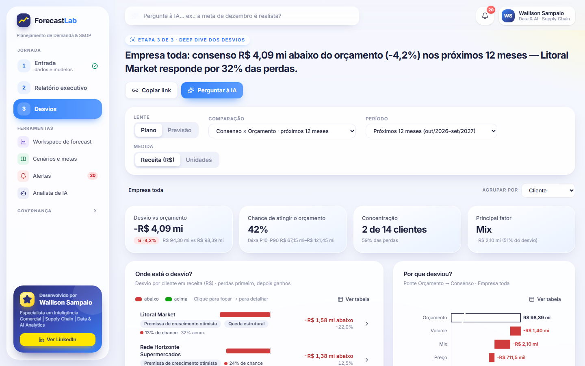 |
| **3 · Desvios — lente Previsão (causas do erro)** | **Analista de IA de Demanda** |
| 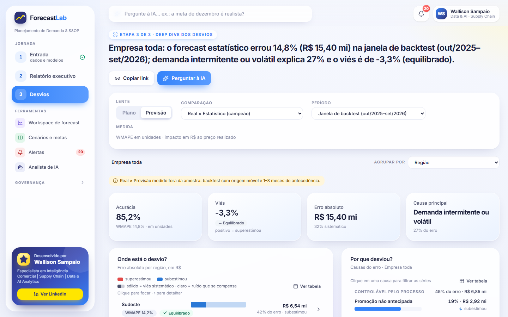 | 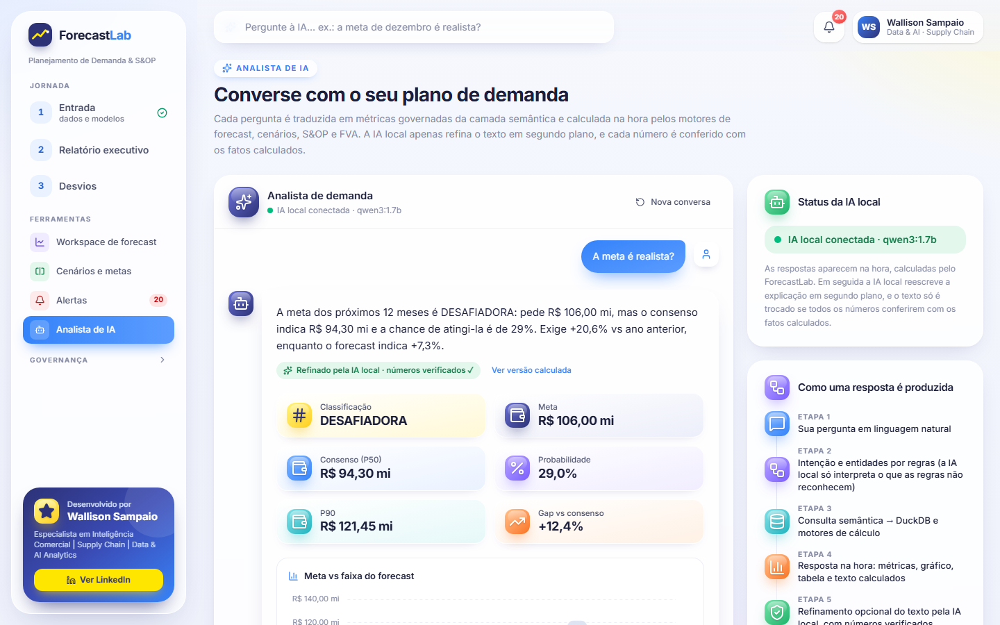 |
| **Workspace de forecast** | **Cenários e metas** |
| 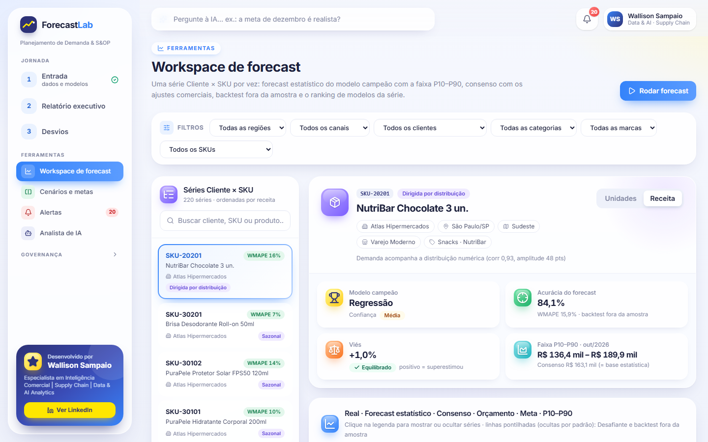 | 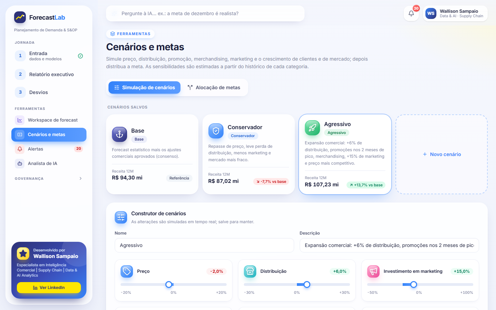 |
| **Modelos e FVA** | **Alertas** |
| 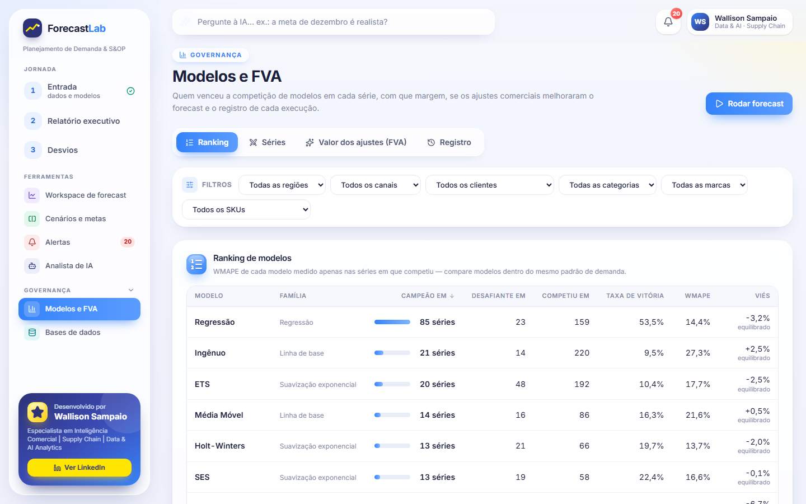 | 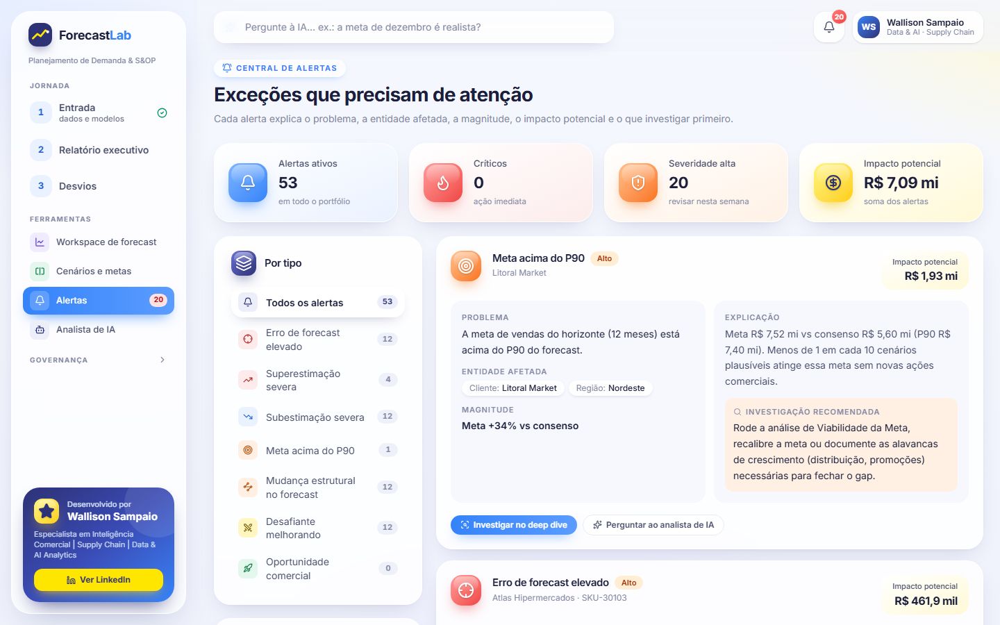 |

> Gere as capturas novamente a qualquer momento com `scripts/capture_screenshots.ps1` (Edge/Chrome headless,
> 1440×900; `-Only entrada,desvios-plano` captura só algumas telas).

## Design premium (soft UI)

A interface foi desenhada como um produto SaaS premium, no estilo dos dashboards modernos de gestão comercial:

* **Fundo em gradiente pastel** e **cards de vidro** brancos com cantos bem arredondados e sombras suaves.
* **Sidebar flutuante** em três grupos (Jornada, Ferramentas, Governança), com as etapas numeradas e cartão de
  autoria; **barra de perguntas à IA no topo** de todas as telas ("Pergunte à IA… ex.: a meta de dezembro é
  realista?").
* **KPIs em tons pastel**, no máximo 4 por linha, sem texto cortado; na jornada, sem ícones (*declutter*).
* **Notação IBCS** nos gráficos da jornada: Real sólido, Orçamento em contorno, Meta tracejada, Forecast hachurado;
  variações sempre com sinal e com a palavra "acima/abaixo", nunca só com cor.
* **Ícones 3D com gradiente** nos títulos dos cards das ferramentas; **abas em formato de pílula**, badges com
  rótulos em português e ícones, e paleta da marca: azul `#3483FA`, navy `#2D3277` e amarelo sol `#FFE600`.
* Sem faixas coloridas laterais e sem emoji na jornada: o destaque vem da superfície tingida, do ícone e da palavra.
* Gráficos sem linhas de grade, com rótulos diretos, `aria-label` e o botão "Ver tabela"; paleta das ferramentas
  validada para daltonismo (ΔE ≥ 8 entre cores vizinhas).
* **Modo apresentação** no relatório (`P` liga, `←`/`→` trocam de capítulo, `Esc` sai).

## O problema

Planejadores de demanda equilibram planilhas de histórico, um forecast estatístico em que ninguém confia
totalmente, ajustes comerciais "no feeling", um orçamento construído a partir do ano anterior e uma meta de vendas
negociada de cima para baixo. A reunião de S&OP acaba discutindo números em vez de decisões:

* Qual forecast está certo — e qual foi a acurácia real dele até agora?
* Os ajustes comerciais dos planejadores melhoraram ou pioraram o forecast?
* O gap vs orçamento é de premissa (orçamento otimista, preço, mix) ou de demanda — e quem o concentra?
* A meta do próximo ano é realista, desafiadora ou simplesmente impossível?
* O que seria preciso (distribuição, preço, promoções) para fechar o gap?

## A solução

```text
Dados históricos → Qualidade dos dados → Competição de modelos → Confiança no forecast      (1 · Entrada)
  → Mensagem e decisões do ciclo de S&OP                                                    (2 · Relatório)
  → Onde, por quê e quando desviamos → ajuste comercial, cenário ou pergunta à IA          (3 · Desvios)
```

| Etapa | O que o ForecastLab faz |
|---|---|
| **Carregar e validar** | `.xlsx` / `.csv` / `.parquet`, nomes de colunas em PT/EN, Diagnóstico da base, **Score de qualidade dos dados (0–100)**, execução bloqueada em caso de erros críticos |
| **Explorar** | Tendência, índice de sazonalidade, volatilidade, intermitência, efeitos de promoção e de distribuição |
| **Perfil das séries** | Cada série Cliente × SKU é classificada (Estável, Crescente, Em declínio, Sazonal, Intermitente, Dirigida por promoção, Dirigida por distribuição, Mudança estrutural, Volátil, Histórico curto, Inativa) |
| **Competição de modelos** | **15 modelos** roteados pelo padrão da série, backtest com origem móvel, WMAPE / Viés / MAE / RMSE / MAPE / sMAPE / MASE, **Campeão e Desafiante**, confiança do modelo, **veredito de confiança** (confiável, cautela ou não confiável) |
| **Forecast probabilístico** | Horizonte de 3 a 24 meses (padrão 12), **P10 / P50 / P90** a partir de erros fora da amostra |
| **Consenso** | Ajustes comerciais a partir de uma **biblioteca de eventos** → Base estatística + Incremental = **Forecast de consenso** |
| **Relatório executivo** | **7 capítulos** gerados no backend com uma única fonte de números: ideia central + SCQA, realizado vs orçamento, precisão, próximos meses, gap, meta e até **5 decisões** por regras determinísticas; exportação em HTML idêntica à tela |
| **Deep dive dos desvios** | **Ponte preço/volume/mix/eventos** exata no grão Cliente × SKU × mês, probabilidade de atingir orçamento/meta, Pareto, recorrência, **causa raiz** do erro (controlável × inerente, viés × ruído), tabela de exceções e ações pré-preenchidas |
| **Cenários** | Base / Conservador / Agressivo / Personalizado, motor de simulação what-if com **elasticidades estimadas a partir do histórico** |
| **S&OP e metas** | **Motor de Viabilidade de metas** (probabilidade, classe e a alavanca que fecharia o gap) e **Alocação de metas** |
| **Governança** | **Forecast Value Added (FVA)**, registro de modelos, registro de execuções, versionamento de bases e central de alertas (cada alerta abre o deep dive) |
| **Analista de IA** | Perguntas livres em português: resposta calculada **na hora**; a IA local (**Ollama**) só refina o texto em segundo plano, com trava de fundamentação, e interpreta as perguntas que as regras não entendem |
| **Exportar** | Planilha de planejamento (Excel), Excel executivo e relatório executivo em HTML autocontido |

## Arquitetura

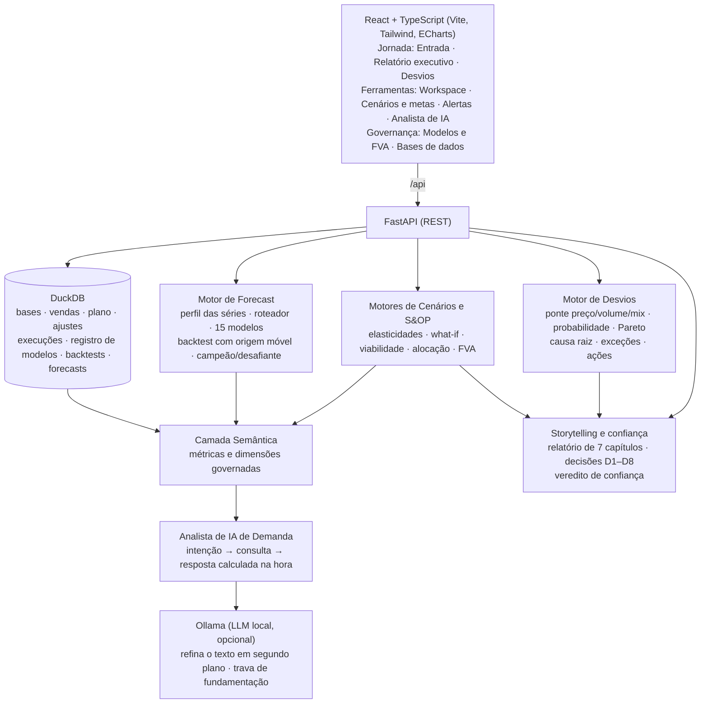

Detalhes: [docs/architecture.md](docs/architecture.md).

## Stack

| Camada | Tecnologia |
|---|---|
| Frontend | React 19, TypeScript (strict), Vite 7, Tailwind CSS 4, Apache ECharts, TanStack Query, Zustand, lucide-react |
| Backend | Python, FastAPI, pandas, NumPy, SciPy, statsmodels, scikit-learn |
| Armazenamento | DuckDB (um único arquivo local), Parquet / CSV / XLSX |
| IA | Ollama local, opcional (escolhe o modelo baixado mais rápido: `qwen3:1.7b`, `llama3.2:3b`…; o Docker baixa o `llama3.2:3b`); sem ele, entra a narrativa determinística |
| Qualidade | pytest (500+ testes), Vitest + Testing Library (220+ testes, incluindo o orçamento visual da jornada), Ruff (lint + format), mypy, ESLint, Prettier |
| Entrega | Docker Compose (frontend + backend + ollama), CI no GitHub Actions |

## Metodologia de forecast

* **Perfil das séries** — ADI / CV² (Syntetos–Boylan), força de tendência e de sazonalidade via STL, teste de
  ponto de mudança único (média em dois segmentos vs. tendência linear), efeito (lift) de promoção e correlação com
  distribuição → tipo da série + justificativa.
* **Roteador de modelos candidatos** — só competem modelos plausíveis (ex.: Croston/SBA/TSB para séries
  intermitentes, Holt-Winters/ETS/SARIMA para sazonais); o Naive é sempre o benchmark.
* **15 modelos** — Naive, Naive Sazonal, Média Móvel · SES, Holt (amortecido), Holt-Winters, ETS (AICc automático) ·
  ARIMA, SARIMA (airline) · Croston, SBA, TSB · Regressão Ridge com tendência/sazonalidade/promoção/preço/
  distribuição/merchandising/marketing/feriados · Random Forest, Gradient Boosting (lag-12 + calendário + drivers).
* **Seleção** — ranking por WMAPE, depois |Viés|, depois RMSE → Campeão e Desafiante; **confiança do modelo**
  (Alta/Média/Baixa) a partir do erro, da estabilidade entre folds, da profundidade do histórico e da margem do
  campeão.
* **Intervalos** — P10/P90 a partir do RMSE **fora da amostra** do backtest do campeão, ampliado por √horizonte.
* **Hierarquia** — forecasts Cliente × SKU reconciliados **bottom-up** em todos os níveis (top-down por participação
  histórica também disponível; MinT no roadmap).

Detalhes completos: [docs/forecasting.md](docs/forecasting.md).

## Metodologia de backtest

Validação cruzada com origem móvel (rolling-origin) e janela expansível (padrão: 4 folds × 3 meses = os últimos
12 meses):

```text
TREINO                       TESTE
out/2021 → set/2025          out–dez/2025
out/2021 → dez/2025          jan–mar/2026
out/2021 → mar/2026          abr–jun/2026
out/2021 → jun/2026          jul–set/2026
```

**Proteção contra vazamento de dados** (garantida por testes em `backend/tests/test_backtest.py`): os modelos só
recebem `y[:origem]`; os drivers da janela de teste ficam **congelados no último nível regular conhecido**
(avaliação ex-ante — o modelo nunca vê as promoções ou os preços que de fato aconteceram); a limpeza de rupturas
usa apenas dados de treino; alterar valores dentro de uma janela de teste nunca muda o forecast daquele fold.

Todo erro de previsão mostrado na jornada (veredito da Entrada, capítulo Precisão, lente Previsão do deep dive) é
esse erro **fora da amostra**, com a antecedência calculada da própria execução ("1–3 meses").

## Arquitetura da IA

```text
Pergunta em linguagem natural
  → Classificador de intenções por pontuação (sinônimos PT/EN, sem acentos, tolerante a erros de digitação)
      (não entendeu? a IA local sugere a intenção, e o ForecastLab valida intenção, entidades e meses)
  → Entidades com correspondência aproximada (clientes, SKUs, produtos, regiões, canais, categorias, marcas, meses)
  → Consulta semântica → Motores DuckDB / Forecast / Cenários / S&OP / Desvios / FVA → Resultado estruturado
  → Resposta calculada NA HORA (< 1,5 s): texto + KPIs + gráfico + tabela
  → Em segundo plano: o LLM local (Ollama) reescreve o texto em 2 frases → travas de números, classificação e
    direção → o texto refinado só substitui o calculado se passar em todas
```

O analista entende perguntas livres e específicas, como *"quanto vamos vender de Bebidas no Sul em dezembro?"*,
*"qual o viés do cliente Atlas?"*, *"me fale sobre o canal Farma"* ou *"e se o preço cair 5%?"* — além das
perguntas clássicas de acurácia, viés, gap vs orçamento, viabilidade de meta, FVA e riscos. O relatório e o deep
dive têm botões **"Perguntar à IA"** com perguntas prontas (testadas contra o classificador) que já levam o recorte
em análise como filtro.

O LLM **nunca produz números** e nunca atrasa a resposta. Cada valor do texto refinado precisa ser rastreável aos
fatos calculados; se o LLM escrever um número sem lastro, mudar a classificação ("desafiadora" → "realista") ou
inverter o sentido de uma variação, o texto é rejeitado e a versão calculada fica. Contrato de resposta:
`{answer, insights, metrics, chart, table, recommendations, filters}` + metadados do cálculo. Veja
[docs/ai_analyst.md](docs/ai_analyst.md).

## Instalação

### Docker (recomendado)

```bash
git clone <repositorio> forecastlab
cd forecastlab
docker compose up
```

Abra **http://localhost:3000** e clique em **Começar**: a jornada abre na Entrada. Na primeira inicialização a
base sintética é gerada e a competição de modelos é executada (cerca de 5 minutos); a Entrada mostra o progresso
e, ao final, o veredito de confiança e o botão "Abrir o relatório". O Ollama baixa o modelo uma única vez (~2 GB).

### Desenvolvimento local (sem Docker)

Backend (Python 3.11+):

```bash
cd backend
python -m venv .venv
.venv/Scripts/python -m pip install -r requirements-dev.txt   # macOS/Linux: .venv/bin/python
.venv/Scripts/python -m uvicorn app.main:app --port 8000
```

Frontend (Node 20.19+):

```bash
cd frontend
npm install
npm run dev
```

IA local opcional: instale o [Ollama](https://ollama.com) e rode `ollama pull qwen3:1.7b` (o mais rápido em CPU)
ou `ollama pull llama3.2:3b`. O ForecastLab escolhe sozinho o modelo baixado (ou o definido em `OLLAMA_MODEL`).
Sem ele, o Analista de IA usa o motor de narrativa determinística (todos os números continuam sendo calculados
pelo ForecastLab).

> **Dica (Windows):** se o caminho da pasta tiver `&` (ex.: `S&OP`), os atalhos do `npm run` podem falhar. Rode as
> ferramentas diretamente, por exemplo `node node_modules/vite/bin/vite.js` ou
> `node node_modules/typescript/bin/tsc -p tsconfig.app.json --noEmit`.

### Testes e qualidade

```bash
cd backend && .venv/Scripts/python -m pytest
cd frontend && npm test && npm run lint
```

## Base de demonstração

`backend/synthetic_data_generator` gera uma base **reproduzível** (`random_seed`) com uma economia plausível:
60 meses (out/2021 → set/2026), 5 regiões (Sudeste, Sul, Nordeste, Centro-Oeste, Norte), 5 canais (Varejo Moderno,
Atacarejo, Varejo Tradicional, E-commerce, Farma), 14 clientes fictícios, 4 categorias (Bebidas, Snacks, Cuidados
Pessoais, Limpeza), 8 marcas, 24 SKUs, 220 séries Cliente × SKU e todos os campos do PRD (Preço, Promoção,
Distribuição, Ruptura, Feriado, Investimento em marketing, Evento de merchandising, Potencial do cliente…).

* Nove padrões de demanda (estável, crescente, em declínio, sazonal, intermitente, dirigido por promoção, dirigido
  por distribuição, mudança estrutural, volátil), além de um lançamento e de deslistagens.
* Eventos detectáveis: Black Friday, Natal, Carnaval (data móvel), Dia das Mães, verão/inverno, promoções,
  merchandising, abertura de lojas, ganhos/perdas de distribuição, rupturas, aumentos/reduções de preço.
* Orçamento anual e metas de vendas (com otimismo/subestimação realistas), 380+ ajustes históricos de
  planejadores para o FVA e eventos comerciais pendentes para o consenso — com tipos de evento ("Promoção",
  "Ganho de distribuição", "Lançamento"…) e responsáveis ("Key Account (KAM)", "Trade Marketing"…) em português.

```bash
cd backend
.venv/Scripts/python -m synthetic_data_generator --seed 42 --out ../data/synthetic --samples ../data/samples
```

`data/samples/forecastlab_sample_upload.xlsx` é um arquivo pronto para carregar na **Entrada** (etapa 1, "Enviar
minha planilha"; recorte das regiões **Sul** e **Centro-Oeste**).

## Estrutura do repositório

```text
forecastlab/
├── frontend/            App React + TypeScript (pages, components/{journey,entrada,story,desvios}, charts, hooks,
│                        lib, services, types)
├── backend/
│   ├── app/             api · ingestion · validation · forecasting · backtesting · metrics · model_selection
│   │                    reconciliation · scenarios · sop · fva · alerts · deviations · story · semantic_layer
│   │                    ai · exports · services
│   ├── synthetic_data_generator/
│   └── tests/
├── data/                synthetic/ (gerado) · samples/ (exemplos para carregar)
├── database/            arquivo DuckDB local (criado em tempo de execução)
├── docs/                jornada, arquitetura, forecast, modelo de dados, API, analista de IA, cenários, S&OP…
├── docker/              Dockerfiles + nginx
├── screenshots/
├── docker-compose.yml
└── .github/workflows/ci.yml
```

## Documentação

[Jornada do usuário](docs/jornada.md) · [Arquitetura](docs/architecture.md) · [Forecast](docs/forecasting.md) ·
[Modelo de dados](docs/data_model.md) · [API](docs/api.md) · [Analista de IA](docs/ai_analyst.md) ·
[Cenários](docs/scenarios.md) · [S&OP, desvios e FVA](docs/sop.md) ·
[Prontidão enterprise](docs/enterprise_readiness.md) · [Segurança](docs/security.md) ·
[Kit LinkedIn](docs/linkedin_kit.md)

## Roadmap

* Fase 1 — Portfólio / Local ✅ (este repositório)
  * ✅ Interface 100% em português com design premium (soft UI)
  * ✅ Analista de IA com perguntas livres em português, resposta na hora e refinamento local em segundo plano
  * ✅ Jornada guiada Entrada → Relatório executivo (storytelling) → Deep dive dos desvios
* Próximos passos: arquivar o forecast publicado em cada ciclo de S&OP (acurácia real com defasagem de 1 e 3
  meses), reconciliação MinT / middle-out, modelos globais de ML (LightGBM entre séries), intervalos conformais,
  fluxo de aprovação de ajustes comerciais, relatório executivo em PDF, modo escuro, versão da interface em inglês
  (i18n).
* Fase 2 — Pronto para enterprise: PostgreSQL / Azure SQL, Data Lake, Entra ID + RBAC, LLM corporativo,
  conectores ERP/SAP, Snowflake / Databricks, AKS / Container Apps, Terraform — veja
  [docs/enterprise_readiness.md](docs/enterprise_readiness.md).

## White-label (logo opcional do cliente)

Em demonstrações privadas para uma empresa específica, o ForecastLab pode exibir o logo do cliente ("Preparado
para") ao lado da própria marca. O arquivo do logo e a configuração ficam apenas na sua máquina (ignorados pelo
git) — veja [frontend/public/brand/README.md](frontend/public/brand/README.md). Use somente logos que você tem
autorização para usar.

## Segurança

Local e seguro por padrão: nenhuma credencial ou chave de API é necessária ou armazenada, a API e as portas do
Docker escutam apenas em `127.0.0.1`, a carga de arquivos tem limite de tamanho e de tipo e o repositório contém
somente dados sintéticos. Não há tela de configurações e a API não expõe caminhos de arquivos locais (como o do
banco DuckDB). Este MVP não tem autenticação, portanto não o publique na internet com dados reais. Veja
[SECURITY.md](SECURITY.md) e [docs/security.md](docs/security.md).

## Aviso

Todos os dados deste projeto são **sintéticos e fictícios**, gerados por código deste repositório. Nenhuma empresa,
cliente, produto ou informação confidencial real é representado. Os forecasts são estimativas estatísticas para
fins de demonstração.

## English summary

**ForecastLab** is a full-stack, local-first **AI Demand Planning & S&OP decision platform** (React 19 + TypeScript +
Tailwind + ECharts · FastAPI + DuckDB + statsmodels/scikit-learn · optional local Ollama LLM, zero paid APIs). It
validates sales history with a data quality score, profiles every Customer × SKU series, runs **15 forecasting
models** in a leakage-safe rolling-origin backtest, selects a **champion and challenger** per series with
**P10/P50/P90** intervals, turns commercial events into a **consensus forecast**, measures **Forecast Value Added**,
simulates **what-if scenarios** with elasticities estimated from history, and tells whether a sales **target is
statistically realistic** — including the lever that would close the gap.

The interface is a **guided three-stage journey**: (1) **Entry — data and models**: validate the data, let the models
compete (scoreboard of wins per model) and get a **trust verdict** on out-of-sample accuracy; (2) **Executive
report**: a 7-chapter data story (Minto pyramid / SCQA, IBCS notation, one visual per chapter, statement headlines
generated server-side from a single source of numbers) ending in up to 5 rule-based **decisions**; (3) **Deviation
deep dive**: where, why and when the plan or the forecast deviated — an exact **price/volume/mix bridge** at
Customer × SKU × month grain, Pareto concentration, recurrence, forecast-error **root cause** (controllable vs
inherent, bias vs noise), exception lists and pre-filled actions (commercial adjustment, scenario, AI question).
Tools (forecast workspace, scenarios and targets, alerts, AI analyst) and governance (models & FVA, datasets) sit
beside the journey.

An **AI analyst** answers free natural-language questions (Portuguese first) **instantly** from governed metrics and
deterministic narratives; a local LLM optionally rewrites the answer in the background, and the rewrite is shown
only if it passes numeric-grounding, verdict and direction guards. The LLM also classifies questions the rules do
not understand, and its output is validated before any computation. The user interface, demo data and reports are
in **Brazilian Portuguese**, with a premium soft-UI design. All data is synthetic.

---

<div align="center">

**ForecastLab**

**Desenvolvido por Wallison Sampaio — Especialista em Inteligência Comercial | Supply Chain | Data & AI Analytics**

*Developed by Wallison Sampaio — Commercial Intelligence | Supply Chain | Data & AI Analytics Specialist*

[www.linkedin.com/in/wallisonsampaio](https://www.linkedin.com/in/wallisonsampaio)

</div>
